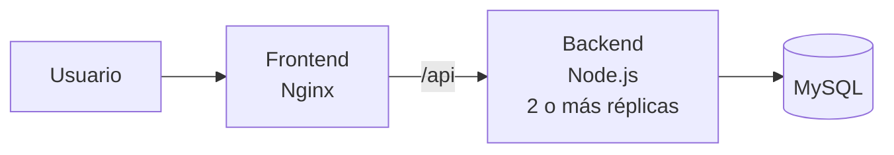
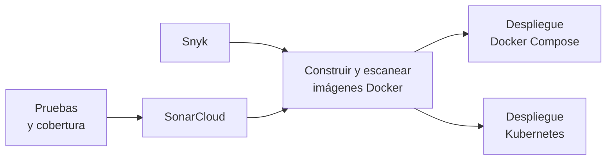

# Tienda Perritos 🐶

[](https://github.com/lBlackDevDUOC/microservicio-devops/actions/workflows/ci-cd.yml)
[](https://sonarcloud.io/summary/new_code?id=lBlackDevDUOC_microservicio-devops)

Este proyecto es un pequeño sistema para administrar el catálogo de una tienda de alimentos para perritos: se pueden listar, crear, editar y eliminar productos desde una página web.

Lo usamos como base para la **Evaluación Parcial 2 de Ingeniería DevOps (DOY0101)**. El objetivo no es tanto la aplicación en sí, sino todo lo que pasa alrededor: cada cambio que subimos se prueba, se analiza en busca de problemas de seguridad, se empaqueta en contenedores y se despliega de forma automática con GitHub Actions.

## ¿Qué tiene el proyecto?

La aplicación tiene tres partes, cada una en su propio contenedor:

| Parte | Tecnología | Qué hace |
|---|---|---|
| **Frontend** | Nginx | Sirve la página web y reenvía las llamadas `/api` al backend |
| **Backend** | Node.js 24 + Express | API REST con el CRUD de productos |
| **Base de datos** | MySQL 8.4 | Guarda los productos (se carga con datos de ejemplo al iniciar) |



Y alrededor de la aplicación:

- **Dockerfiles** para los tres servicios.
- **Docker Compose** para levantar todo junto en cualquier computador.
- **Manifiestos de Kubernetes** con autoescalado, alta disponibilidad y reglas de red.
- **Pruebas unitarias** con Jest.
- **Pipeline CI/CD** en GitHub Actions con análisis de calidad y seguridad (SonarCloud, Snyk y Dependabot).

```text
.
├── backend/          API (código en src/, pruebas en tests/)
├── frontend/         Página web + configuración de Nginx
├── db/               Imagen de MySQL con el script inicial
├── k8s/              Manifiestos de Kubernetes
├── scripts/          Pruebas de humo que se corren después de cada despliegue
├── .github/          Pipeline (workflows/ci-cd.yml) y Dependabot
└── docker-compose.yml
```

## Cómo levantarlo

Solo necesitas **Docker Desktop** (o Docker con Compose v2).

1. Clona el repositorio y entra a la carpeta:

   ```bash
   git clone https://github.com/lBlackDevDUOC/microservicio-devops.git
   cd microservicio-devops
   ```

2. Crea el archivo de configuración a partir del ejemplo (ahí van las contraseñas de MySQL; puedes dejarlas como están para probar):

   ```bash
   cp .env.example .env
   ```

3. Levanta todo:

   ```bash
   docker compose up -d --build --wait
   ```

4. Abre <http://localhost:8080> y listo.

Algunos comandos útiles:

```bash
docker compose ps                                  # ver el estado de los contenedores
docker compose up -d --scale tienda-backend=3      # escalar el backend a 3 réplicas
bash scripts/smoke-test.sh http://localhost:8080   # probar que todo responde bien
docker compose down -v                             # apagar y borrar los datos
```

Para correr las pruebas unitarias necesitas Node.js 24:

```bash
cd backend
npm ci
npm test
```

La API queda disponible en `http://localhost:8080/api/productos`, y hay dos endpoints de salud: `/api/health` (el servicio está vivo y muestra la versión desplegada) y `/api/ready` (además confirma que hay conexión con MySQL).

## Cómo funciona el pipeline

Todo está en [`.github/workflows/ci-cd.yml`](.github/workflows/ci-cd.yml). Trabajamos con GitFlow: las funcionalidades se desarrollan en ramas `feature/...`, se integran a `develop` mediante pull request y, cuando están listas, pasan a `main`.



Las etapas, en orden:

1. **Pruebas:** se instalan las dependencias, se revisa el código con ESLint y se corren las pruebas unitarias con cobertura.
2. **Calidad y seguridad:** SonarCloud revisa el código y Snyk busca vulnerabilidades en las librerías. En los pull requests también se revisa que no entren dependencias nuevas con vulnerabilidades.
3. **Imágenes:** se construyen las tres imágenes Docker, Snyk las escanea y, si todo está bien, se publican en GitHub Container Registry.
4. **Despliegue:** se levanta el sistema completo con Docker Compose y también en un clúster de Kubernetes de 3 nodos, y se corren pruebas de humo para comprobar que funciona de verdad.

Lo que pasa depende de dónde se suben los cambios:

| Cuándo | Qué se ejecuta |
|---|---|
| Push a una rama `feature/...` | Pruebas, Snyk y construcción de imágenes (sin publicarlas) |
| Pull request a `develop` o `main` | Lo anterior + SonarCloud + revisión de dependencias |
| Push a `develop` | Todo + publicación de imágenes + despliegue en **staging** |
| Push a `main` | Todo + publicación de imágenes + despliegue en **production** |

El pipeline también se puede lanzar a mano desde la pestaña **Actions → CI/CD tienda-perritos → Run workflow**, eligiendo `develop` o `main`.

> Los despliegues se hacen en un **entorno cloud simulado**: una máquina de GitHub Actions donde el pipeline levanta el sistema, lo prueba y luego lo destruye. "Staging" y "production" son los nombres de los entornos en GitHub; no hay servidores externos.

## Pruebas y calidad

Las pruebas están en [`backend/tests`](backend/tests) y usan **Jest** y **Supertest** (lo equivalente a JUnit y JaCoCo en Java). Son 54 pruebas que cubren los casos importantes:

- crear, consultar, actualizar y eliminar productos;
- las validaciones (por ejemplo, que el stock no pueda ser negativo ni el precio menor que cero);
- ids inválidos, JSON mal formado y rutas que no existen;
- qué pasa cuando la base de datos falla o no responde;
- que el servicio no arranque si faltan las credenciales.

La base de datos se reemplaza por un objeto de prueba, así que las pruebas no necesitan MySQL y corren en un par de segundos.

**Nuestra política de calidad**, que el pipeline aplica de forma automática:

| Regla | Si no se cumple… |
|---|---|
| Todas las pruebas deben pasar | el pipeline se detiene |
| Cobertura mínima del **80 %** (actualmente ~99 % de líneas y ~92 % de ramas) | el pipeline se detiene |
| ESLint sin errores | el pipeline se detiene |
| Quality Gate de SonarCloud aprobado | el pull request queda bloqueado |
| Pruebas de humo después del despliegue | el despliegue se marca como fallido |

Los reportes de cobertura y de pruebas quedan descargables en cada ejecución (artefacto `test-reports`), y el porcentaje de cobertura aparece en el resumen del pipeline.

## Seguridad y escalabilidad

**Análisis de seguridad en el pipeline:**

- **Dependabot** revisa cada semana las dependencias de npm, las imágenes Docker y las acciones de GitHub, y abre pull requests cuando hay actualizaciones.
- **Snyk** analiza las librerías del backend y también las imágenes Docker ya construidas.
- **SonarCloud** analiza el código en busca de bugs, vulnerabilidades y malas prácticas.
- **npm audit** y **Dependency Review** son una segunda capa de revisión de dependencias.

**Bloqueos y alertas:** si Snyk encuentra una vulnerabilidad alta o crítica, o si SonarCloud no aprueba el código, el pipeline se detiene y la imagen nunca llega a publicarse ni desplegarse. Los hallazgos aparecen en la pestaña **Security** del repositorio, GitHub avisa por correo cuando algo falla, y si falla en `develop` o `main` el pipeline abre automáticamente un *issue* asignado a quien hizo el cambio.

**Otras medidas:**

- Ninguna contraseña está en el código: las del pipeline son tokens guardados en *GitHub Secrets* y las de MySQL se generan al azar en cada despliegue.
- Los contenedores no se ejecutan como root y tienen permisos mínimos (sistema de archivos de solo lectura, sin capacidades extra).
- A las imágenes finales les quitamos lo que no se usa en ejecución, como npm en el backend y gosu en MySQL, para tener menos superficie de ataque.
- La base de datos está en una red interna a la que no se puede acceder desde afuera.

**Escalabilidad:**

- En Docker Compose, el backend corre con 2 réplicas y se puede escalar con `--scale`. Cada servicio tiene límites de CPU y memoria.
- En Kubernetes, el backend escala solo entre **2 y 10 réplicas** según el uso de CPU y memoria (HPA), y el frontend entre 2 y 6.
- Las actualizaciones se hacen sin cortar el servicio (*rolling update*) y siempre queda al menos una réplica disponible (*PodDisruptionBudget*).

## Despliegue y trazabilidad

Cada vez que algo llega a `develop` o `main`, el pipeline lo despliega automáticamente con las imágenes que acaba de construir y probar, y después corre [`scripts/smoke-test.sh`](scripts/smoke-test.sh), que revisa que la página cargue, que la API responda, que haya conexión con la base de datos, que el CRUD funcione y que las validaciones rechacen datos inválidos.

Para poder seguir un cambio desde el código hasta el entorno:

- **Cada imagen se etiqueta con el commit** que la generó (por ejemplo, `tienda-backend:b7c8aa5...`), y los despliegues usan siempre esa etiqueta, nunca `latest`.
- El endpoint **`/api/health` devuelve la versión desplegada**, y las pruebas de humo comprueban que coincida con el commit.
- Cada despliegue queda registrado en la sección **Environments** de GitHub (staging / production) y guarda un registro descargable (artefacto `deployment-compose`) con el commit, la rama, quién lo hizo, la fecha y las imágenes exactas.
- Las imágenes publicadas incluyen un **SBOM** (la lista de todo lo que contienen) y una **atestación** firmada que demuestra desde qué commit y qué pipeline se construyeron.
- En Kubernetes, `kubectl rollout history` muestra qué commit corresponde a cada versión desplegada.

## Orquestación

Usamos las dos opciones que vimos en el curso:

**Docker Compose** ([`docker-compose.yml`](docker-compose.yml)) se usa para trabajar en local y para el despliegue rápido del pipeline. Los servicios arrancan en orden y cada uno espera a que el anterior esté *saludable* (no solo encendido), el backend y la base de datos están en una red interna, los datos se guardan en un volumen y cada contenedor tiene límites de recursos.

**Kubernetes** ([`k8s/`](k8s)) es la versión pensada para producción, y el pipeline la despliega en un clúster real de 3 nodos:

| Recurso | Para qué |
|---|---|
| `StatefulSet` + volumen persistente | MySQL no pierde los datos si el pod se reinicia |
| `Deployment` del backend y del frontend | 2 réplicas, actualizaciones sin corte y chequeos de salud |
| `HorizontalPodAutoscaler` | Escala según la carga |
| `PodDisruptionBudget` | Siempre queda al menos un pod disponible |
| `NetworkPolicy` | Solo se permite el tráfico usuario → frontend → backend → base de datos |
| `Service` | Frontend expuesto con LoadBalancer; backend y BD solo internos |

Para desplegarlo a mano en un clúster:

```bash
kubectl create namespace tienda
kubectl create secret generic mysql-secret -n tienda --from-literal=MYSQL_ROOT_PASSWORD=<clave> --from-literal=MYSQL_USER=<usuario> --from-literal=MYSQL_PASSWORD=<clave>
kubectl apply -k k8s/
```

## Relación con la pauta de evaluación

| Indicador | Dónde se ve |
|---|---|
| **IE1** Contenedores | `backend/Dockerfile` (multi-stage), `frontend/Dockerfile`, `db/Dockerfile` y el job *Imagen* del pipeline |
| **IE2** Pruebas automatizadas | `backend/tests`, umbral de cobertura en `backend/package.json` y el job *Pruebas unitarias y cobertura* |
| **IE3** Seguridad y escalabilidad | `.github/dependabot.yml`, jobs de SonarCloud y Snyk, pestaña Security, HPA y límites de recursos |
| **IE4** Despliegue automático y trazabilidad | Jobs de despliegue, pestaña Environments, imágenes etiquetadas por commit y esta documentación |
| **IE5** Orquestación | `docker-compose.yml` y la carpeta `k8s/` |

## Uso de inteligencia artificial

> _Sección a completar por el equipo._

- Herramienta(s) utilizada(s): _…_
- Cómo la usamos y cómo revisamos lo que generó: _…_
- Referencia según la guía de Bibliotecas Duoc UC: <https://bibliotecas.duoc.cl/ia>

## Conclusiones y reflexiones

> _Cada integrante escribe su reflexión personal (según la pauta, sin apoyo de IA)._

### _Integrante 1_

_…_

### _Integrante 2_

_…_
