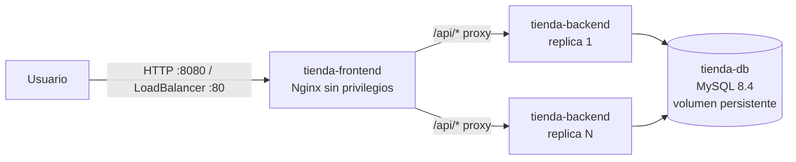
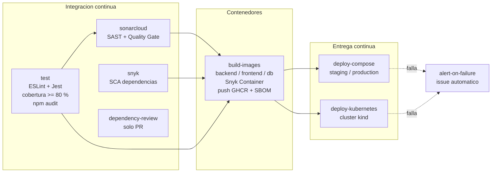

# tienda-perritos

[](https://github.com/lBlackDevDUOC/microservicio-devops/actions/workflows/ci-cd.yml)

Microservicio para administrar el catalogo de una tienda de alimentos para perritos. Separa un backend Node.js/Express, un frontend web servido por Nginx y una base de datos MySQL. Cada componente se ejecuta en contenedores, se orquesta con Docker Compose y Kubernetes, y su ciclo de vida completo (pruebas, analisis de seguridad, construccion de imagenes y despliegue) esta automatizado con GitHub Actions.

> **Evaluacion Parcial 2 - DOY0101 Ingenieria DevOps:** "Anadiendole complejidad a nuestro pipeline". La seccion [Cumplimiento de la pauta](#cumplimiento-de-la-pauta-ep2) relaciona cada indicador con su evidencia en el repositorio.

## Tabla de contenidos

1. [Arquitectura](#arquitectura)
2. [Estructura del proyecto](#estructura-del-proyecto)
3. [Contenedores (IE1)](#contenedores-ie1)
4. [Pipeline CI/CD](#pipeline-cicd)
5. [Politicas de calidad y pruebas (IE2)](#politicas-de-calidad-y-pruebas-ie2)
6. [Seguridad y escalabilidad (IE3)](#seguridad-y-escalabilidad-ie3)
7. [Despliegue automatico y trazabilidad (IE4)](#despliegue-automatico-y-trazabilidad-ie4)
8. [Orquestacion (IE5)](#orquestacion-ie5)
9. [Configuracion inicial del repositorio](#configuracion-inicial-del-repositorio)
10. [Ejecucion local](#ejecucion-local)
11. [GitFlow y buenas practicas](#gitflow-y-buenas-practicas)
12. [Cumplimiento de la pauta EP2](#cumplimiento-de-la-pauta-ep2)
13. [Uso de IA y reflexiones](#uso-de-inteligencia-artificial)

## Arquitectura



| Componente | Tecnologia | Puerto | Endpoints de salud |
|---|---|---|---|
| `tienda-frontend` | Nginx 1.27 (imagen *unprivileged*) | 8080 | `/healthz` |
| `tienda-backend` | Node.js 24 + Express | 3001 | `/api/health` (liveness), `/api/ready` (readiness, consulta MySQL) |
| `tienda-db` | MySQL 8.4 LTS | 3306 | `mysqladmin ping` |

API REST del backend:

| Metodo | Ruta | Descripcion |
|---|---|---|
| GET | `/api/productos` | Lista los productos |
| GET | `/api/productos/:id` | Obtiene un producto |
| POST | `/api/productos` | Crea un producto (valida nombre, precio >= 0 y stock entero >= 0) |
| PUT | `/api/productos/:id` | Actualiza un producto |
| DELETE | `/api/productos/:id` | Elimina un producto |

## Estructura del proyecto

```text
.
├── .github/
│   ├── dependabot.yml            # Escaneo de dependencias npm, Docker y Actions
│   ├── kind-config.yaml          # Cluster Kubernetes efimero del pipeline
│   └── workflows/ci-cd.yml       # Pipeline CI/CD completo
├── backend/
│   ├── Dockerfile                # Multi-stage: deps -> test -> runtime
│   ├── src/                      # app.js (rutas), db.js (pool), validators.js
│   ├── tests/                    # Pruebas unitarias Jest + Supertest
│   ├── server.js                 # Punto de entrada con apagado ordenado
│   └── package.json              # Scripts, umbral de cobertura 80 %
├── db/
│   ├── Dockerfile                # MySQL 8.4 + esquema inicial (sin credenciales)
│   └── init.sql
├── frontend/
│   ├── Dockerfile                # Nginx sin privilegios
│   ├── default.conf.template     # Proxy al backend + cabeceras de seguridad
│   ├── index.html
│   └── app.js
├── k8s/                          # Manifiestos Kubernetes (kustomize)
├── scripts/smoke-test.sh         # Pruebas de humo post-despliegue
├── docker-compose.yml            # Orquestacion local / entorno simulado
├── sonar-project.properties      # Configuracion de SonarCloud
└── .env.example                  # Variables requeridas por Docker Compose
```

## Contenedores (IE1)

Cada servicio tiene su propio `Dockerfile`, pensado para ser pequeno, seguro y reproducible:

| Practica | backend | frontend | db |
|---|---|---|---|
| Imagen base oficial, liviana y con version fijada | `node:24-alpine` | `nginxinc/nginx-unprivileged:1.27-alpine` | `mysql:8.4` |
| Multi-stage (solo lo necesario en la imagen final) | Si: `deps` -> `test` -> `runtime` | N/A (archivos estaticos) | N/A |
| Usuario sin privilegios | `node` (uid 1000) | `nginx` (uid 101) | `mysql` (uid 999 en Kubernetes) |
| `HEALTHCHECK` | `/api/health` | `/healthz` | `mysqladmin ping` |
| Sin secretos dentro de la imagen | Si | Si | Si (antes tenia contrasenas en `ENV`) |
| Etiquetas OCI con commit y version | Si | Si | Si |
| `.dockerignore` | Si | Si | - |

El backend usa la etapa `deps` para instalar solo dependencias de produccion con `npm ci --omit=dev`, por lo que Jest, ESLint y Supertest **no** llegan a la imagen final. La etapa `test` permite ejecutar las pruebas dentro de un contenedor (`docker build --target test backend`). Resultado: backend ~256 MB y frontend ~74 MB.

## Pipeline CI/CD

Archivo: [`.github/workflows/ci-cd.yml`](.github/workflows/ci-cd.yml)



| Evento | Jobs que se ejecutan |
|---|---|
| Push a `feature/**` o `hotfix/**` | test, sonarcloud, snyk, build-images (sin publicar) |
| Pull request a `develop` o `main` | lo anterior + dependency-review |
| Push a `develop` (o *Run workflow* manual sobre `develop`) | todo + publicacion en GHCR + despliegue en entorno **staging** |
| Push a `main` (o *Run workflow* manual sobre `main`) | todo + publicacion en GHCR (tag `latest`) + despliegue en entorno **production** |

| Job | Que hace | Bloquea si... |
|---|---|---|
| `test` | `npm ci`, ESLint, `node --check` del frontend, Jest con cobertura, `npm audit --omit=dev --audit-level=high`, publica reportes JUnit/LCOV/Cobertura | falla una prueba, la cobertura baja de 80 %, hay errores de lint o vulnerabilidades altas |
| `sonarcloud` | Analisis estatico (bugs, code smells, vulnerabilidades, hotspots) y cobertura | el Quality Gate de SonarCloud no se cumple (`sonar.qualitygate.wait=true`) |
| `snyk` | Analisis de composicion (SCA) de `package-lock.json`; sube SARIF a *Security > Code scanning* | hay vulnerabilidades de severidad alta o critica |
| `dependency-review` | Compara las dependencias que agrega un PR | el PR introduce dependencias con vulnerabilidades altas |
| `build-images` | Build multi-stage con cache, escaneo Snyk Container, push a GHCR con SBOM, provenance y atestacion | Snyk detecta vulnerabilidades altas en las capas propias de la imagen |
| `deploy-compose` | Despliega el stack con las imagenes del commit, ejecuta smoke tests, escala el backend a 3 replicas y guarda el registro del despliegue | algun smoke test falla o un contenedor no queda `healthy` |
| `deploy-kubernetes` | Crea un cluster kind de 3 nodos, carga las imagenes, aplica `k8s/` con kustomize, espera los rollouts y ejecuta smoke tests | un rollout no termina o falla un smoke test |
| `alert-on-failure` | Abre un issue con etiqueta `pipeline-failure` asignado al autor del commit | - |

## Politicas de calidad y pruebas (IE2)

Pruebas unitarias en [`backend/tests`](backend/tests) con **Jest** y **Supertest** (equivalente en Node.js a JUnit + JaCoCo en Java). El pool de MySQL se inyecta en `createApp({ pool })`, por lo que las pruebas reemplazan la base de datos por un doble de prueba y no necesitan infraestructura.

Casos criticos cubiertos (52 pruebas):

- CRUD completo con respuestas 200/201/404.
- Reglas de negocio: precio >= 0, stock entero >= 0 (correccion del hotfix `validacion-stock`), largo de nombre y descripcion.
- Validacion de ids (`/api/productos/abc` -> 400 sin consultar la base de datos).
- JSON mal formado -> 400; rutas inexistentes -> 404.
- Errores de base de datos -> 500 con mensaje controlado.
- Readiness: 200 si MySQL responde, 503 si no.
- Configuracion: el servicio no arranca sin credenciales (no hay contrasenas por defecto).

**Politica de calidad del proyecto** (aplicada automaticamente por el pipeline):

| Regla | Herramienta | Umbral |
|---|---|---|
| Todas las pruebas deben pasar | Jest | 100 % |
| Cobertura minima de lineas, sentencias, funciones y ramas | Jest `coverageThreshold` | >= 80 % (actual: ~99 % lineas, ~88 % ramas) |
| Sin errores de estilo/bugs estaticos | ESLint | 0 errores |
| Quality Gate | SonarCloud | *Sonar way* aprobado |
| Pruebas post-despliegue | `scripts/smoke-test.sh` | 10/10 verificaciones |

```bash
cd backend
npm ci
npm test               # pruebas
npm run test:ci        # pruebas + cobertura + reporte JUnit
```

El reporte HTML de cobertura queda en `backend/coverage/lcov-report/index.html` y se publica como artefacto `test-reports` en cada ejecucion del pipeline.

## Seguridad y escalabilidad (IE3)

### Seguridad en el pipeline (DevSecOps)

| Tipo | Herramienta | Momento |
|---|---|---|
| SCA (dependencias) | Dependabot, Snyk, `npm audit`, Dependency Review | continuo / cada push / cada PR |
| SAST (codigo propio) | SonarCloud, ESLint | cada push |
| Escaneo de contenedores | Snyk Container | cada build de imagen |
| Cadena de suministro | SBOM + provenance + atestacion de GitHub | cada publicacion |

- **Bloqueos:** cualquier hallazgo de severidad alta o critica, o un Quality Gate fallido, detiene el pipeline. Como `build-images` depende de `test`, `sonarcloud` y `snyk`, una imagen insegura nunca se publica ni se despliega.
- **Alertas:** los resultados SARIF de Snyk aparecen en *Security > Code scanning*; Dependabot genera alertas y PRs automaticos; GitHub notifica por correo los workflows fallidos; y el job `alert-on-failure` abre un issue en `develop`/`main`.
- **Secretos:** `SONAR_TOKEN` y `SNYK_TOKEN` viven en *GitHub Secrets*. Las credenciales de MySQL se generan aleatoriamente en cada despliegue (`openssl rand`) y nunca se versionan (`.env` esta en `.gitignore`; el antiguo `mysql-secret.yaml` con contrasenas se reemplazo por un ejemplo).
- **Minimo privilegio en GitHub Actions:** `permissions: contents: read` global y permisos adicionales solo por job.
- **Contenedores endurecidos:** usuarios no root, `read_only`, `cap_drop: ALL`, `no-new-privileges`, red `backend-net` interna (MySQL y backend sin acceso desde fuera ni salida a Internet).
- **Aplicacion:** validacion de entradas, consultas parametrizadas, limite de 100 kb en el cuerpo, sin cabecera `X-Powered-By`, cabeceras `CSP`, `X-Frame-Options`, `X-Content-Type-Options` en Nginx y renderizado sin `innerHTML` en el frontend (evita XSS).
- **Kubernetes:** Pod Security Standards (`baseline` obligatorio, `restricted` auditado), `securityContext` con `runAsNonRoot`, `readOnlyRootFilesystem`, `seccompProfile: RuntimeDefault`, sin token de service account y `NetworkPolicy` de denegacion por defecto.

### Escalabilidad y desempeno

| Parametro | Docker Compose | Kubernetes |
|---|---|---|
| Replicas del backend | `BACKEND_REPLICAS=2`, escalable con `--scale` (el pipeline prueba 3) | 2 a 10 con HPA (CPU 70 %, memoria 80 %) |
| Replicas del frontend | 1 | 2 a 6 con HPA (CPU 60 %) |
| Limites de recursos | `deploy.resources` por servicio | `requests`/`limits` por contenedor |
| Disponibilidad | healthchecks + `depends_on: service_healthy` | probes startup/readiness/liveness + `PodDisruptionBudget` |
| Despliegue sin caida | - | `RollingUpdate` con `maxUnavailable: 0` |
| Distribucion | - | `topologySpreadConstraints` entre nodos |
| Conexiones a BD | pool configurable `DB_POOL_SIZE` | igual |

## Despliegue automatico y trazabilidad (IE4)

Cada push a `develop` o `main` despliega automaticamente en dos entornos *cloud* simulados dentro del runner de GitHub:

1. **Docker Compose** (`deploy-compose`) asociado a los *GitHub Environments* `staging` (develop) y `production` (main).
2. **Kubernetes** (`deploy-kubernetes`) en un cluster kind de 1 control-plane + 2 workers.

Ambos usan exactamente las imagenes construidas y escaneadas en ese mismo commit y terminan con [`scripts/smoke-test.sh`](scripts/smoke-test.sh), que valida frontend, health, version, conexion a MySQL, CRUD completo, regla de stock y cabeceras de seguridad.

### Como se garantiza la trazabilidad

| Desde | Hasta | Mecanismo |
|---|---|---|
| Requisito / cambio | Commit | Ramas GitFlow + Conventional Commits + PR con CI obligatorio |
| Commit | Ejecucion del pipeline | Cada run muestra el SHA, autor y rama; artefactos `test-reports` con resultados y cobertura |
| Commit | Imagen | Tags `<sha completo>`, `sha-<corto>`, nombre de rama y `latest` (solo main); etiqueta OCI `org.opencontainers.image.revision`; SBOM, provenance y atestacion firmada |
| Imagen | Entorno | Compose y kustomize despliegan la imagen por SHA (nunca `latest`); historial en *Deployments* de GitHub (`staging`/`production`) |
| Entorno | Version en ejecucion | `GET /api/health` devuelve `version` = SHA del commit, verificado por el smoke test |
| Despliegue | Auditoria | Artefacto `deployment-compose` (JSON con commit, rama, actor, URL del run, fecha e imagenes con digest) y `kubectl rollout history` con `change-cause` |
| Falla | Responsable | Issue automatico con enlace al commit y al run, asignado al autor |

## Orquestacion (IE5)

### Docker Compose

[`docker-compose.yml`](docker-compose.yml) define los tres servicios con:

- dependencias por **estado de salud** (`depends_on: condition: service_healthy`), resolviendo la limitacion de `depends_on` simple;
- dos redes (`frontend-net` publica y `backend-net` interna);
- volumen persistente `db-data`;
- limites y reservas de CPU/memoria;
- replicas configurables del backend balanceadas por el DNS interno de Docker;
- politica de reinicio y rotacion de logs.

### Kubernetes

Manifiestos en [`k8s/`](k8s), agrupados con [`kustomization.yaml`](k8s/kustomization.yaml):

| Recurso | Proposito |
|---|---|
| `namespace.yaml` | Namespace `tienda` con Pod Security Standards |
| `mysql-statefulset.yaml` + `mysql-service.yaml` | MySQL con identidad estable y `PersistentVolumeClaim` (antes era `Deployment` con `emptyDir` y perdia datos) |
| `backend-deployment.yaml` / `frontend-deployment.yaml` | Rolling update sin caida, probes, recursos, contexto de seguridad |
| `*-service.yaml` | ClusterIP interno para el backend; LoadBalancer para el frontend (NLB en EKS) |
| `*-hpa.yaml` | Autoescalado horizontal con politicas de estabilizacion |
| `*-pdb.yaml` | Minimo de pods disponibles ante mantenciones |
| `network-policies.yaml` | Solo se permite publico -> frontend -> backend -> db |
| `mysql-secret.example.yaml` | Ejemplo; el Secret real se crea fuera del repositorio |

Despliegue manual (por ejemplo en EKS):

```bash
kubectl create namespace tienda
kubectl create secret generic mysql-secret -n tienda --from-literal=MYSQL_ROOT_PASSWORD=<root> --from-literal=MYSQL_USER=<usuario> --from-literal=MYSQL_PASSWORD=<password>
kubectl apply -k k8s/
kubectl -n tienda get pods,svc,hpa
```

## Configuracion inicial del repositorio

Pasos que se hacen una sola vez en GitHub (requieren cuenta del equipo):

1. **SonarCloud:** iniciar sesion en [sonarcloud.io](https://sonarcloud.io) con GitHub, importar `microservicio-devops`, **desactivar *Automatic Analysis*** (*Administration > Analysis Method*) y generar un token en *My Account > Security*. Verificar que `sonar.projectKey` y `sonar.organization` de [`sonar-project.properties`](sonar-project.properties) coincidan con los del proyecto.
2. **Snyk:** crear cuenta en [snyk.io](https://snyk.io) y copiar el token desde *Account settings*.
3. **Secrets:** en *Settings > Secrets and variables > Actions* crear `SONAR_TOKEN` y `SNYK_TOKEN`.
4. **Dependabot:** en *Settings > Code security* activar *Dependency graph*, *Dependabot alerts* y *Dependabot security updates*.
5. **Environments:** en *Settings > Environments* crear `staging` y `production` (opcional: revisores obligatorios en `production`).
6. **Proteccion de ramas:** en `main` y `develop` exigir pull request, una aprobacion y los checks `Pruebas unitarias y cobertura`, `Analisis de codigo (SonarCloud)`, `Vulnerabilidades en dependencias (Snyk)` e `Imagen backend/frontend/db`.

## Ejecucion local

Requisitos: Docker Desktop (o Docker Engine + Compose v2) y Node.js 24 para correr las pruebas.

```bash
cp .env.example .env          # luego editar las contrasenas
docker compose up -d --build --wait
```

- Frontend: <http://localhost:8080>
- API a traves del frontend: <http://localhost:8080/api/productos>
- Escalar el backend: `docker compose up -d --scale tienda-backend=3`
- Pruebas de humo: `bash scripts/smoke-test.sh http://localhost:8080 dev`
- Detener y borrar datos: `docker compose down -v`

## GitFlow y buenas practicas

Se mantiene el modelo **GitFlow** de la evaluacion anterior:

- **`main`:** codigo estable desplegado en *production*. Recibe PR desde `develop` o `hotfix/*`.
- **`develop`:** integracion continua del trabajo terminado; se despliega en *staging*.
- **`feature/nombre`:** funcionalidad aislada creada desde `develop`.
- **`hotfix/nombre`:** correccion urgente desde `main`, integrada luego a `main` y `develop`.

Convenciones:

- Commits con [Conventional Commits](https://www.conventionalcommits.org/): `feat`, `fix`, `docs`, `refactor`, `test`, `ci`, `chore` (ej. `ci: agrega escaneo snyk al pipeline`).
- Ramas en minusculas con guiones: `feature/filtro-productos`, `hotfix/validacion-stock`.
- PR pequenos, con descripcion del problema, solucion y verificacion; al menos una aprobacion de otro integrante; nunca hacer merge con checks fallidos; preferir *Squash and merge*.
- Dependabot abre sus PRs contra `develop` con prefijos `chore(deps)`, `chore(docker)` y `ci(deps)`.

## Cumplimiento de la pauta EP2

| Indicador | Requisito del encargo | Evidencia |
|---|---|---|
| **IE1** Contenedores | Dockerfile del microservicio; build de imagen en el pipeline | `backend/Dockerfile` multi-stage, `frontend/Dockerfile`, `db/Dockerfile`; job `build-images` |
| **IE2** Pruebas automatizadas | Pruebas unitarias en el pipeline | Jest + Supertest (52 pruebas), umbral de cobertura 80 %, job `test` |
| **IE3** Escalabilidad y seguridad | Dependabot + SonarCloud/Snyk; bloqueos/alertas si falla la seguridad | `.github/dependabot.yml`, jobs `sonarcloud`, `snyk`, `dependency-review`, Snyk Container, `alert-on-failure`; HPA, PDB, limites de recursos |
| **IE4** Despliegue automatico y trazabilidad | Despliegue en entorno simulado; README con trazabilidad y calidad | jobs `deploy-compose` y `deploy-kubernetes`, smoke tests, environments, tags por SHA, registro de despliegue; este README |
| **IE5** Orquestacion | Estrategia con Kubernetes o Docker Compose | `docker-compose.yml` y `k8s/` (StatefulSet, HPA, PDB, NetworkPolicy, kustomize) desplegados por el pipeline |

## Uso de inteligencia artificial

> Seccion obligatoria segun las instrucciones de la evaluacion. **Debe ser completada por el equipo.**

- Herramienta(s) utilizada(s): _(por ejemplo: Claude Code, Anthropic)_
- Como se aplico: _(describir en que partes se uso como apoyo y como se revisaron y validaron los resultados)_
- Cita segun la guia de Bibliotecas Duoc UC: <https://bibliotecas.duoc.cl/ia>

## Conclusiones y reflexiones individuales

> Segun la pauta, esta seccion debe ser redactada por cada integrante **sin apoyo de IA**.

### Integrante 1 - _(nombre)_

_(Reflexion personal: aprendizaje y contribucion al proyecto.)_

### Integrante 2 - _(nombre)_

_(Reflexion personal: aprendizaje y contribucion al proyecto.)_
